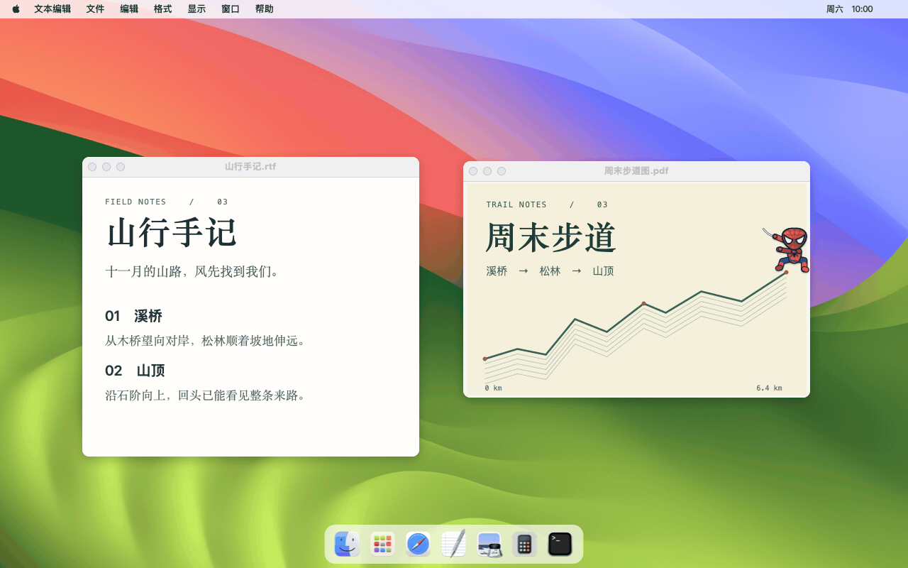

# Sisyphus · 向上

**删掉蜘蛛侠挂着的那个字。他往下一掉，反手粘住旁边的笔画，借着坠势荡到你眼前。**

Sisyphus 是一个原生 macOS 桌宠游戏。新条茜会背对着你，抓住笔画往上爬。换成蜘蛛侠，同一扇屏幕多了一点纵深：他荡近时手套变大、影子拉开；荡回文档时身体缩小，蛛丝始终钉在原来那一点。够不到下一处边缘，他还是会摔到底，重新出发。

**[下载 Mac 版 · v0.6.0](https://github.com/rzr002/sisyphus-desktop/releases/download/v0.6.0/Sisyphus-0.6.0-macOS-arm64.zip)**

Apple Silicon（M 系列），macOS 14 或更高版本。游戏在主显示器上运行。



*这张动图用 macOS 系统壁纸、示例文档和 PDF 在后台生成，没有录制任何人的桌面。蜘蛛侠和蛛丝由游戏的像素识别与运动引擎实时计算。*

## 在你的文档里试一次

1. 解压下载的 ZIP，把 **Sisyphus.app** 拖进「应用程序」并打开。这个预览版使用临时签名，尚未经过 Apple 公证。首次启动被系统拦下时，可查看 [Apple 的打开说明](https://support.apple.com/zh-cn/102445)。
2. 首次使用，右键小人选 **允许读取桌面…**，按 macOS 提示在「录屏与系统录音」中允许 Sisyphus。下次打开同一版本会使用已有授权。拒绝后小人会等你主动启用。画面只在本机分析，不录音、不保存、不上传。[Apple 权限说明](https://support.apple.com/zh-cn/guide/mac-help/mchld6aa7d23/mac)
3. 打开「文本编辑」，把窗口放到靠近桌面底部的位置，在靠近屏幕底部的地方打几行字。等她抓上去，再删掉手边的那行字。
4. 右键角色，选 **外观 → 蜘蛛侠**。把他拖到屏幕中部、一行深色文字的斜下方再松手。他会先掉一小段，再抬手射丝；接住后，那一跌会变成一道摆弧。丝飞到前删掉目标，或在贴近地面时松手，他就会落地。
5. 把两扇窗口并排放，中间露出一条壁纸。等他荡进两个高支点之间，两根蛛丝会拉成 V 字。他屈膝后拉，两线一起松开，腾空后再伸手接丝。

摆得够快，他会单手悬着，一条腿向前剪出，另一条向后收，再借着摆势把腿收回来。只剩一个高支点时，等他摆到慢处，还能看到他头朝下放低身体，悬停片刻，再卷丝翻正。桌面边缘和近地位置会限制他能使出的招式。

## 桌面上只有角色

| 操作 | 会发生什么 |
| --- | --- |
| 左键拖动，松手 | 把人物拎到别处。蜘蛛侠在一次坠落里有一次射丝自救的机会。 |
| 右键、双指点按或 Control + 单击 | 暂停、重新出发、切换外观、调速或退出。 |
| 鼠标快速掠过人物 | 碰落正在攀爬或荡丝的角色。把鼠标停在身上，人物会等你操作。设置里可关闭干扰。 |
| 右键 → 外观 → 导入角色 | 支持透明 PNG、Shimeji 图片文件夹和自定义动作包。选择会保留到下次启动。[角色包格式](docs/CHARACTER_PACKS.zh-CN.md) |

重复打开 App 也只保留一个角色。蛛丝所在的位置仍可以点选文字。能接收鼠标输入的只有人物周围的小块区域。开启 macOS「辅助功能 → 显示 → 减弱动态效果」后，摆荡和自救仍然可玩，人物大小保持不变。

## 她怎么知道哪里能抓

Swift、AppKit 和 ScreenCaptureKit 在主显示器上比较相邻像素的颜色差异。字的笔画、图标轮廓、图表折线都可能成为支点，大片纯色和缓慢渐变会让角色沿地面找路。同一套判定适用于文档、网页和图像。特别淡的纹理可能检测不到。

蜘蛛侠会把丝固定在支点中的一个边缘像素上。拉索收短时身体靠近锚点，放长后由重力驱动摆荡。接近桌面底部时他会提前收短蛛丝，净空不足时不做翻身。删字、滚动或移动窗口时，游戏会重新检查原处的纹理和窗口。技术细节见 [像素地形与蛛丝运动](docs/TECHNICAL_DESIGN.zh-CN.md)。

<details>
<summary>人物一直待在地面</summary>

若你主动停止过共享，右键小人选「重新连接桌面」。如果已经给过录屏权限，先退出小人，再打开当时授权的那份 App。源码目录和「应用程序」里可能各有一份同名的 Sisyphus。预览版使用临时签名，换成另一份构建可能需要单独授权。要启用新版，可以从新版小人的右键菜单进入录屏权限设置。发布者在历次打包时使用同一团队的 Developer ID Application 签名（`CODESIGN_IDENTITY`），可让 macOS 在升级后继续识别这款 App。[Apple 对签名身份的说明](https://developer.apple.com/documentation/technotes/tn3127-inside-code-signing-requirements)

如果桌面读取正常，把一行对比明显的文字移到屏幕底部附近。普通角色要先从地面够到第一处支点；蜘蛛侠也需要射程内有真实边缘。
</details>

## 从源码运行

在装有 Swift 5.10 或更高版本及 macOS SDK 的 Mac 上运行。构建脚本会生成可直接打开的应用。

```bash
git clone https://github.com/rzr002/sisyphus-desktop.git
cd sisyphus-desktop
bash scripts/build-app.sh
./启动游戏.command
```

以后双击项目里的 `启动游戏.command` 即可。它会复用已有的 `dist/Sisyphus.app`。如果「应用程序」里有另一版正在运行，会先退出那一版，再打开项目版。

核心检查用 `bash scripts/swift-local.sh run ClimbChecks`。原生窗口、真实屏幕读取和发布包的验证方法见 [验证记录](docs/VERIFICATION.md)。

新条茜与蜘蛛侠均以非官方同人桌宠形式呈现，角色权利归各自权利人。素材制作方式和官方参考见 [角色图像说明](docs/CHARACTER_ART.md)。
