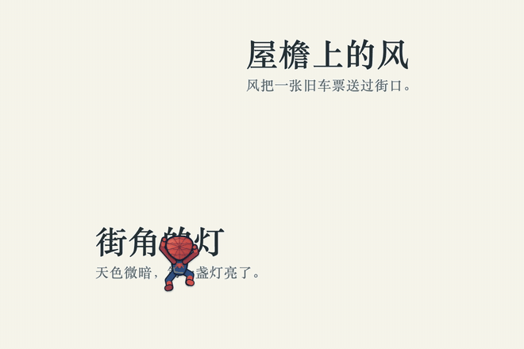
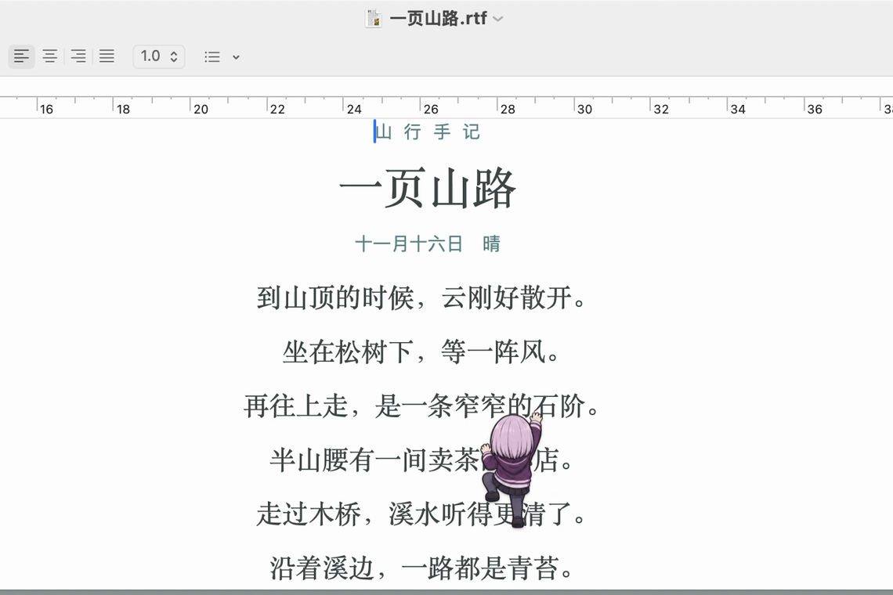
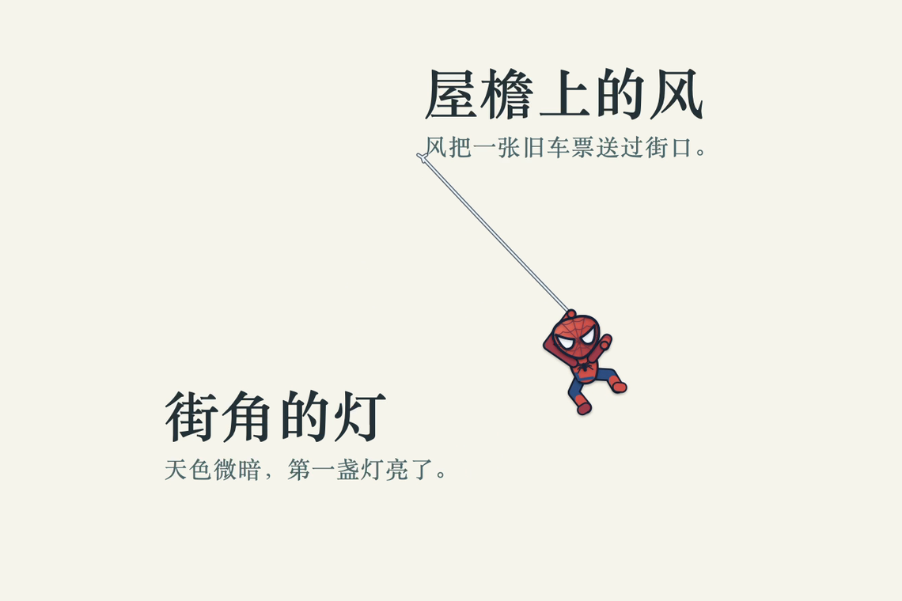

# Sisyphus · 向上

**删掉蜘蛛侠挂着的那个字，他就会从你的桌面上掉下来。**

Sisyphus 是一个原生 macOS 桌宠游戏。新条茜会背对着你，抓着文档里的笔画往上爬。换成蜘蛛侠，他能把蛛丝挂到另一段文字上，拉过中间的留白，然后在你的字下面荡秋千。摔到底，两个人都会自己再出发。

**[下载 Mac 版 · v0.3.0](https://github.com/rzr002/sisyphus-desktop/releases/download/v0.3.0/Sisyphus-0.3.0-macOS-arm64.zip)**　·　[观看 15 秒桌面实录](docs/media/desktop-demo.mp4)

Apple Silicon（M 系列），macOS 14 或更高版本。游戏在主显示器上运行。



*同一次桌面实录。上方那段文字被删除时，下方的字还留在原处。*

## 在你的文档里试一次

1. 解压下载的 ZIP，把 **Sisyphus.app** 拖进「应用程序」并打开。这个预览版使用临时签名，尚未经过 Apple 公证。首次启动被系统拦下时，可查看 [Apple 的打开说明](https://support.apple.com/zh-cn/102445)。
2. 在「系统设置 → 隐私与安全性 → 录屏与系统录音」中允许 **Sisyphus**，按系统提示重新打开。桌宠用这项权限读取可见像素。它只在本机分析画面，不录音、不保存画面、不上传。 [Apple 权限说明](https://support.apple.com/zh-cn/guide/mac-help/mchld6aa7d23/mac)
3. 打开「文本编辑」，把窗口放到靠近桌面底部的位置，在靠近屏幕底部的地方打几行字。等她抓上去，再删掉手边的那行字。
4. 右键角色，选 **外观 → 蜘蛛侠**。在两段字之间留出一块空白。够不着下一段时，他会瞄准范围内的笔画发丝；爬到有空间的高处，又会自己放长蛛丝来回荡。

| 新条茜在「文本编辑」里背身换手 | 蜘蛛侠在文档的两段文字之间摆荡 |
| --- | --- |
|  |  |

## 桌面上只有角色

| 操作 | 会发生什么 |
| --- | --- |
| 左键拖动，松手 | 把人物拎到别处，松手后自然落下。 |
| 右键、双指点按或 Control + 单击 | 暂停、重新出发、切换外观、调速或退出。 |
| 鼠标快速掠过人物 | 碰落正在攀爬或荡丝的角色。把鼠标停在身上，人物会等你操作。设置里可关闭干扰。 |
| 右键 → 外观 → 导入角色 | 支持透明 PNG、Shimeji 图片文件夹和自定义动作包。选择会保留到下次启动。[角色包格式](docs/CHARACTER_PACKS.zh-CN.md) |

蛛丝所在的位置仍可以点选文字。能接收鼠标输入的只有人物周围的小块区域。

## 她怎么知道哪里能抓

Swift、AppKit 和 ScreenCaptureKit 在主显示器上比较相邻像素的颜色差异。字的笔画、图标轮廓、图表折线都可能成为支点，大片纯色和缓慢渐变会让角色沿地面找路。同一套判定适用于文档、网页和图像。特别淡的纹理可能检测不到。

蜘蛛侠会把丝固定在支点中的一个边缘像素上。拉索收短时身体靠近锚点，放长后由重力驱动摆荡。删字、滚动或移动窗口时，游戏会重新检查原处的纹理和窗口。技术细节见 [像素地形与蛛丝运动](docs/TECHNICAL_DESIGN.zh-CN.md)。

<details>
<summary>人物一直待在地面</summary>

右键看看菜单。出现「桌面读取尚未生效」时，请检查 Sisyphus 的录屏权限，按系统提示重启，或选择「重新连接桌面」。如果刚换过临时签名版本，系统可能仍记着上一版。可移除权限列表中原有的 Sisyphus 条目，重新添加「应用程序」里的这一份。

如果桌面读取正常，把一行对比明显的文字移到屏幕底部附近。普通角色要先从地面够到第一处支点；蜘蛛侠也需要射程内有真实边缘。
</details>

## 从源码运行

在装有 Swift 5.10 或更高版本及 macOS SDK 的 Mac 上运行。构建脚本会生成可直接打开的应用。

```bash
git clone https://github.com/rzr002/sisyphus-desktop.git
cd sisyphus-desktop
bash scripts/build-app.sh
open dist/Sisyphus.app
```

核心检查用 `bash scripts/swift-local.sh run ClimbChecks`。原生窗口、真实屏幕读取和发布包的验证方法见 [验证记录](docs/VERIFICATION.md)。

新条茜与蜘蛛侠均以非官方同人桌宠形式呈现，角色权利归各自权利人。素材制作方式和官方参考见 [角色图像说明](docs/CHARACTER_ART.md)。
